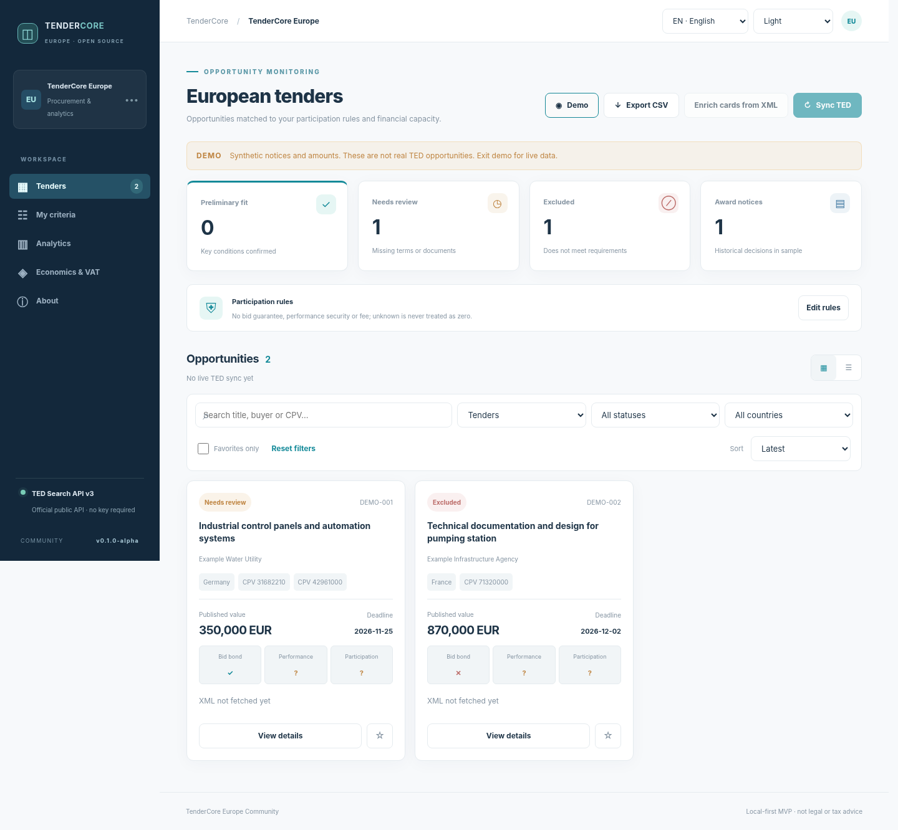
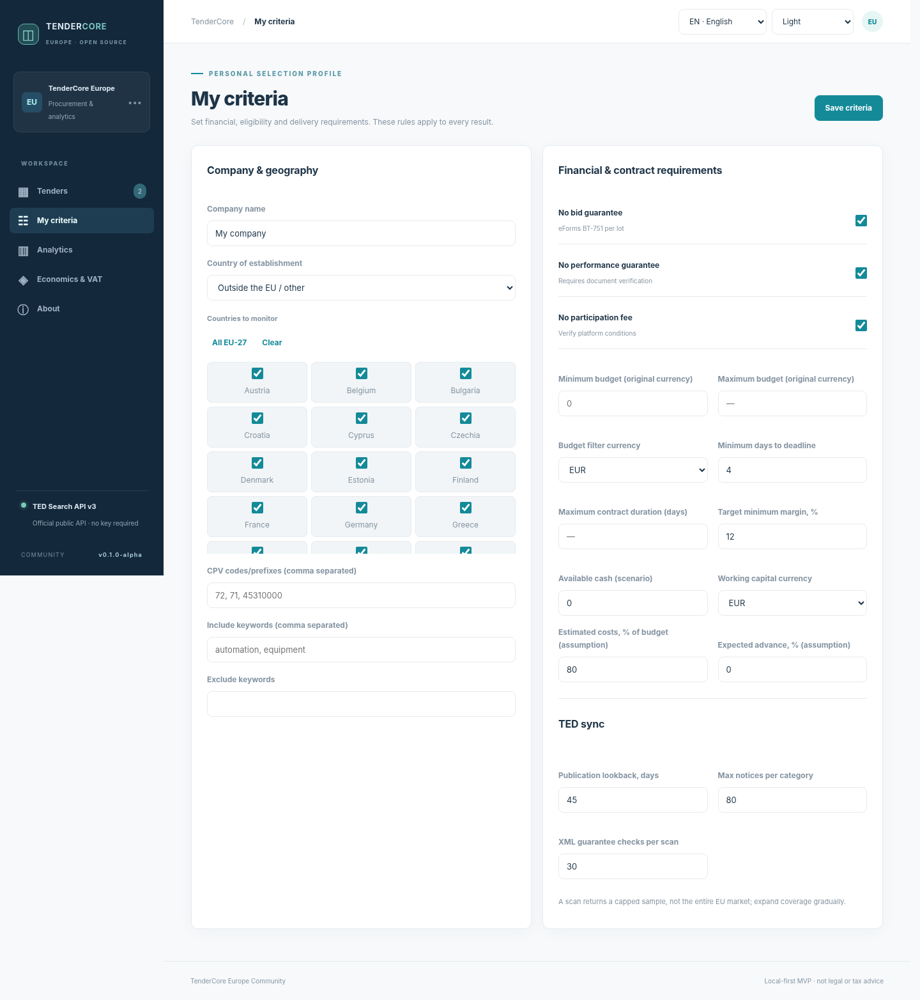
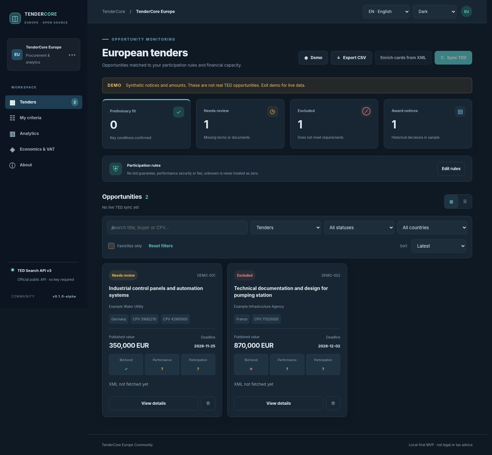

# TenderCore Europe Community

**Open-source, self-hosted European public-tender discovery and preliminary eligibility assessment.**  
**Status: `v0.1.0-alpha`** — experimental release based on internal TenderCore Europe MVP v0.4.2. Not production-ready.



TenderCore Europe helps suppliers explore public tenders published in [Tenders Electronic Daily (TED)](https://ted.europa.eu/), inspect tender and lot information, flag potentially restrictive financial terms, and track their own participation decisions.

**It does not determine legal eligibility, guarantee absence of bid/performance security, calculate authoritative EU-wide taxes or predict winning odds.** Missing information is displayed as **unknown** or **requires review**, never as a confirmed zero cost.

## Features

- TED Search API v3 connector and eForms XML enrichment by lot (requires live verification).
- Russian/English interface; System, Light and Dark themes.
- Tile/list view, country and CPV filters, favorites, source links and CSV export.
- Bid guarantee indicators when explicitly present; manual review for other security/fees.
- Historical-award summary **only for the notices actually synchronized**, keeping currencies separate.
- Editable company preferences, preliminary cross-border VAT scenarios and finance calculator.
- Demo mode uses **synthetic sample notices only**, never mixed into the live database.
- Data stored locally in SQLite, no account or TED API key required for public Search API.

## Quick start (macOS/Linux/Windows with Python 3.11+)

```bash
python -m venv .venv
source .venv/bin/activate  # On Windows: .venv\Scripts\activate
python -m pip install -r requirements.txt
python app.py
```

Open <http://127.0.0.1:8766>. Try demo mode first. **Do not expose port 8766 to the Internet**: there is no user authentication.

### Docker

```bash
docker compose up --build
```

The Compose configuration binds the service to **127.0.0.1 only** and persists local data in a named volume.

## Data sources and limitations

- [TED Search API v3 documentation](https://docs.ted.europa.eu/api/latest/search.html).
- [EU eForms documentation](https://docs.ted.europa.eu/eforms/latest/).
- Data source: Publications Office of the European Union, **TED**. Always open the official notice, tender documents and national e-procurement platform before bidding.
- TED search provides a capped page/sample, not all relevant EU tenders. Some national/local notices are outside TED.
- XML fields differ by notice and country; full eligibility and financial requirements often require contract documents and expert review.
- A live Search API end-to-end test and field mapping validation remain outstanding in this release.
- Reference VAT information is informational. Tax treatment depends on jurisdictions, supplier/customer status, nature of delivery, place of supply and current national law.

## Screenshots

Screenshots are generated against the local FastAPI API using **synthetic demo notices**, not actual TED opportunities. They are tested for browser errors before being saved.





To regenerate verified screenshots:

```bash
python -m pip install -r requirements-dev.txt
python -m playwright install chromium
python scripts/capture_screenshots.py
```

Do not capture a raw `file://` or `about:blank` HTML preview without its API: relative `/api/...` requests will fail. The screenshot script uses an in-process FastAPI test client and avoids real TED requests.

## Development

```bash
python -m unittest discover -s tests -v
python scripts/prepublish_audit.py
```

See [architecture](docs/ARCHITECTURE.md), [design system](docs/DESIGN_SYSTEM.md), [known limitations](docs/RELEASE_CHECKLIST.md), [security](SECURITY.md) and [contributing](CONTRIBUTING.md).

## License

Apache License 2.0 — see [LICENSE](LICENSE). This license covers project code, not third-party data, brands or independent dependencies. An official TED API is not maintained by this project.
